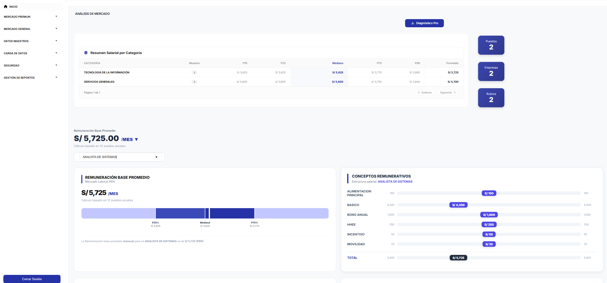

# 💼 Enterprise Compensation Benchmarking & Salary Analytics Platform

> **HR Analytics & Solution Architecture Case Study** — Data-driven compensation intelligence platform for market salary benchmarking, percentile analysis, and internal pay equity.

---

## 🎯 Business Challenge
Human Resources leaders and Compensation & Benefits managers often struggle to evaluate whether their salary bands are competitive against the market. Managing salary surveys in disconnected spreadsheets makes it difficult to calculate statistical percentiles (P10–P90), compare total compensation packages, and ensure internal pay equity across job roles.

## 💡 Solution Overview
I architected and developed a web-based **Compensation & Market Intelligence Platform** that centralizes multi-company salary data and automates statistical benchmarking. HR executives can upload market data, filter by job role or industry category, and immediately visualize salary distributions, percentiles, and detailed remuneration breakdowns.

## 🔄 Key Capabilities & Workflow
1. **Bulk Market Data Ingestion:** Centralized upload and master data management for roles, companies, and industry sectors.
2. **Statistical Percentile Engine:** Automated calculation of market benchmarks (**P10, P25, Median, P75, P90**) and average base salaries (monthly or annualized).
3. **Total Compensation Breakdown:** Granular visualization of fixed and variable pay components (Base Salary, Annual Bonus, Allowances, Incentives) positioned against market ranges.
4. **Executive Diagnostics & Reporting:** Built-in diagnostic tools and automated report generation to support compensation committee decisions.

## 🖥️ System Preview

*Market analysis dashboard displaying category summaries, statistical salary percentiles (P25, Median, P75), and itemized compensation ranges.*

## 📈 Business Value Delivered
* **Data-Driven Talent Retention:** Enables HR teams to adjust salary bands accurately using real market percentiles rather than guesswork.
* **Total Rewards Visibility:** Clarifies how fixed and variable benefits contribute to total employee compensation.
* **Streamlined HR Operations:** Replaces manual spreadsheet calculations with an auditable, role-based web platform.

## 🛠️ Technologies & Standards
* **Analytics & Visualization:** Interactive Statistical Charts, Range Bars, Percentile Modeling
* **Architecture & Security:** Role-Based Access Control (RBAC), Master Data Management, Automated Reporting
* **Web Platform:** Responsive Enterprise UI, Bulk Data Processing Engine
